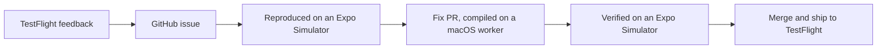
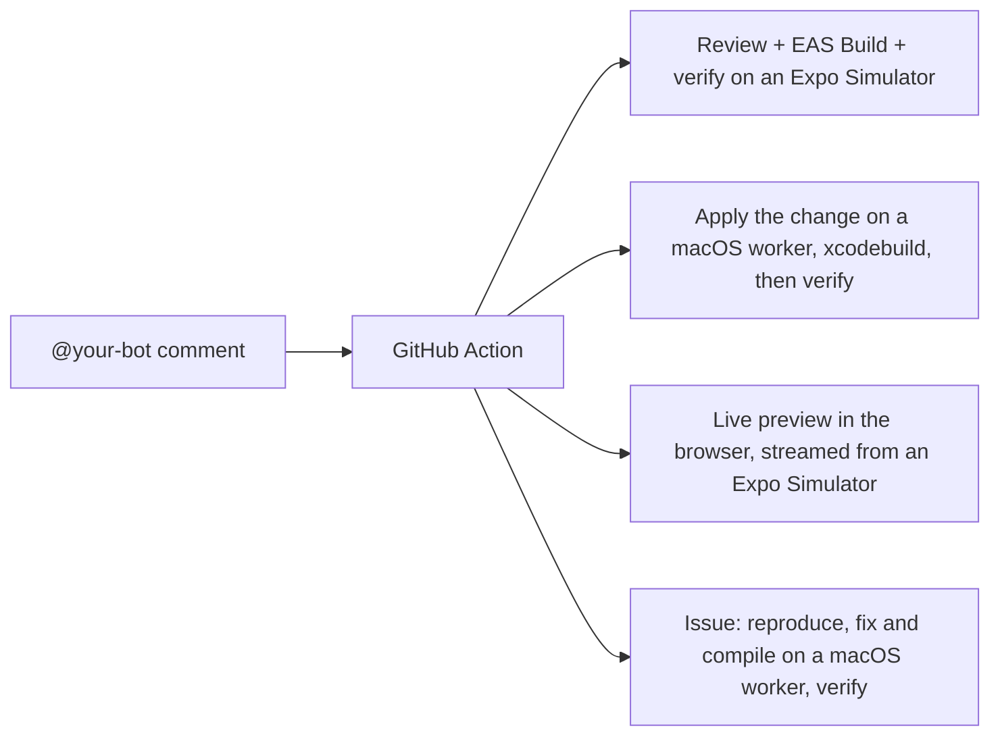
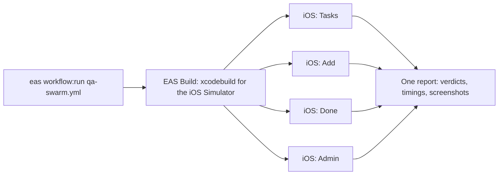

# Agentic Workflows + Expo Simulators, native edition

A demo of agentic workflows on EAS for a native app. This is the SwiftUI counterpart of [jacobhammerle/todo-app](https://github.com/jacobhammerle/todo-app): the same three-screen todo app, with no Expo SDK, no React Native, and no JavaScript. [EAS Workflows](https://docs.expo.dev/eas/workflows/get-started/) hand work to coding agents, the agents drive the app on [Expo Simulators](https://docs.expo.dev/eas/simulators/) in the cloud, and every step leaves a verdict and screenshots on GitHub. EAS is not only for React Native apps.

What changes when the app is native: [EAS Build](https://docs.expo.dev/build/introduction/) compiles the Xcode project in [ios/](ios/) on every run, because there is no JavaScript to fingerprint, repack, or ship as an [update](https://docs.expo.dev/eas-update/introduction/). The agents that write code run on an EAS macOS worker and compile their change with `xcodebuild` before they push, where the Expo repo gates on `tsc` and lint. A merge ships as a new TestFlight build, never over the air. The app is iOS only, so there are no Android lanes. Everything else, the feedback loop, the bot, the swarm, the evidence sites, is the same.

## Feature/Bug Agentic Workflow

1. **A tester reports a bug or feature.** They take a screenshot in the [TestFlight](https://docs.expo.dev/submit/testflight/) build, write a short description, and tap Submit.
2. **An agent files the issue.** App Store Connect [fires](https://docs.expo.dev/eas/workflows/syntax/) an [EAS Workflow](https://docs.expo.dev/eas/workflows/get-started/). An agent reads the description and the screenshot, decides whether it is a bug or a feature request, and opens a GitHub issue with reproduction steps.
3. **An agent reproduces it on an Expo Simulator.** A second workflow builds the app and boots an [Expo Simulator](https://docs.expo.dev/eas/simulators/) with it, follows the reproduction steps, and takes screenshots as it goes. It posts a verdict on the issue: replicated or not.
4. **An agent fixes it.** If confirmed, an agent on an EAS macOS worker makes the fix or enhancement in Swift, `xcodebuild` must pass, and it opens a pull request.
5. **Two agents verify the fix.** One reviews the diff. The other runs the PR's build on a fresh Expo Simulator and taps through the change. The verdict and the [evidence](https://github.com/jacobhammerle/eas-simulator-evidence) land on the PR.
6. **You merge.** A push to `main` that touches the app builds a new store binary and [submits it to TestFlight](https://docs.expo.dev/submit/testflight/). There is no JavaScript, so there is no over-the-air path; the tester gets the fix in the next TestFlight build.

<br>



## Comment-driven Agentic Helpers

Mention the bot on a pull request or an issue and a GitHub Action routes the comment to an [EAS Workflow](https://docs.expo.dev/eas/workflows/get-started/). Every helper runs on an [Expo Simulator](https://docs.expo.dev/eas/simulators/). The mention is yours to pick: it is the `botHandle` field in [package.json](package.json), `@expo-bot` by default, and every message and branch name follows it.

1. **`@your-bot`** or **`@your-bot review [guidance]`** on a PR. One agent reviews the diff, EAS Build compiles the PR, and a second agent runs the build on an Expo Simulator and taps through the change. The verdict and screenshots land on the PR.
2. **`@your-bot <instruction>`** on a PR. An agent on a macOS worker applies the change, `xcodebuild` must pass, the commit is pushed to the PR branch, then the review and verification above follow. `@your-bot change <instruction>` stops after the push.
3. **`@your-bot preview [minutes] [device]`** on a PR. Builds the PR's app, boots an Expo Simulator running it, and posts a browser link, so anyone can drive it. Words in any order, for example `@your-bot preview iPhone 17 Pro for 45`.
4. **`@your-bot [guidance]`** on an issue. Reproduce on an Expo Simulator; if replicated, a macOS worker writes and compiles a fix, opens a PR, and the PR is verified on a second simulator. Guidance such as missing repro steps goes to the replication agent.

The modes are small shell scripts in [scripts/agent/](scripts/agent/), one per helper, and the agent prompts are Markdown files in [.eas/](.eas/). Add a mode, drop one, or rewrite what an agent is asked to check.

<br>



## Agentic QA Swarm

One command tests the whole app at once. Four agents each get their own [Expo Simulator](https://docs.expo.dev/eas/simulators/) in the cloud and one short flow to check, so a full pass takes as long as the slowest lane instead of four flows in a row. Every verdict comes with screenshots.

```bash
eas workflow:run qa-swarm.yml
eas workflow:run qa-swarm.yml -F build_id=<id>
```

1. **EAS Build compiles the app** for the iOS Simulator, or a build id is passed in. There is no JavaScript, so there is no fingerprint check and no repack step: the binary is the whole app.
2. **Four lanes run at the same time.** Four iPhone simulators boot with the build installed, each driven by a headless coding agent with one flow: toggle a task on the Tasks tab, add a task, complete one and clear history on the Done tab, or load a demo preset on the Admin tab. The agent reads the accessibility tree, taps through the flow, screenshots each step, and writes a verdict. A lane's job status is its verdict. This example spins up four at once but you could easily spin up 40.
3. **One report stitches the swarm together.** Lane verdicts, timings (parallel against serial), simulator minutes, and the [evidence](https://github.com/jacobhammerle/eas-simulator-evidence) sites land on the run's report page.

The flows are short Markdown files in [.eas/qa-flows/](.eas/qa-flows/), one per lane. Add a lane by adding a flow and a job in [qa-swarm.yml](.eas/workflows/qa-swarm.yml). The evidence pages are built by eas-simulator-evidence 0.2.4, and the scripts run eas-cli 26.0.0, the version that package is checked against. The Admin tab has a lane here: it shows build provenance and demo presets, and there are no update channels to switch, so loading a preset cannot reload the app out from under the agent.

<br>



## Try it on your own project

See [SETUP.md](SETUP.md). To build and run the app itself:

```bash
npm run build:simulator                       # xcodebuild → build/SimpleTodo.app
npm run smoke -- --app build/SimpleTodo.app   # run it on an Expo Simulator and smoke-test it
```

Open [ios/SimpleTodo.xcodeproj](ios/SimpleTodo.xcodeproj) in Xcode to work on the app. The project is generated from [ios/project.yml](ios/project.yml) with [XcodeGen](https://github.com/yonaskolb/XcodeGen); run `npm run xcodegen` after editing the spec and commit both.
