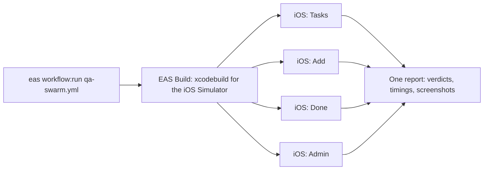
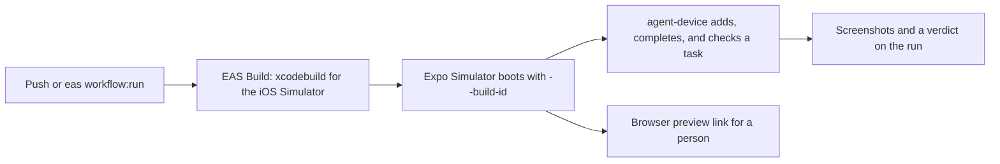

# Agentic Workflows + Expo Simulators, native edition

The native counterpart of [jacobhammerle/todo-app](https://github.com/jacobhammerle/todo-app). That repo is an Expo app; this one is the same three-screen todo app rewritten in SwiftUI, with no Expo SDK, no React Native, and no JavaScript in the app. Both are delivered the same way: [EAS Build](https://docs.expo.dev/build/introduction/) compiles the project, [Expo Simulators](https://docs.expo.dev/eas/simulators/) runs it in the cloud, coding agents drive it, and [EAS Workflows](https://docs.expo.dev/eas/workflows/get-started/) tie the three together. EAS is not only for React Native apps.

| | [todo-app](https://github.com/jacobhammerle/todo-app) (Expo) | This repo (native) |
| --- | --- | --- |
| App | Expo Router + `@expo/ui` | SwiftUI ([ios/SimpleTodo/](ios/SimpleTodo/)) |
| Build | EAS Build, fingerprint-matched `preview` builds, repacked with the current JavaScript | EAS Build, `simulator` profile in [eas.json](eas.json); every run builds or takes a build id |
| Run in the cloud | Expo Simulators, iOS and Android | Expo Simulators, stock iOS Simulator |
| Drive | argent (QA swarm), agent-device | argent (QA swarm), agent-device (smoke test, live preview, `/tab-check`) |
| Ship a change | EAS Update when only JavaScript changed, a new build otherwise | A new build, always |
| Agents | QA swarm, `@expo-bot` PR and issue helpers, TestFlight feedback loop | QA swarm |

## Agentic QA Swarm

One command tests the whole native app at once. Four agents each get their own Expo Simulator in the cloud and one short flow to check, so a full pass takes as long as the slowest lane instead of four flows in a row. Every verdict comes with screenshots.

```bash
eas workflow:run qa-swarm.yml
eas workflow:run qa-swarm.yml -F build_id=<id>
```

1. **EAS Build compiles the app** for the iOS Simulator with the `simulator` profile, or a build id is passed in. There is no JavaScript, so there is no fingerprint check and no repack step: the binary is the whole app.
2. **Four lanes run at the same time.** Four iPhone simulators boot with the build installed and launched (`eas simulator:start --type argent --build-id`), each driven by a headless coding agent with one flow: toggle a task on the Tasks tab, add a task, complete one and clear history on the Done tab, or load a demo preset on the Admin tab. The agent reads the accessibility tree, taps through the flow, screenshots each step, and writes a verdict. A lane's job status is its verdict. This example spins up four at once; a flow file and a job add a lane.
3. **One report stitches the swarm together.** Lane verdicts, timings (parallel against serial), simulator minutes, and the [evidence](https://github.com/jacobhammerle/eas-simulator-evidence) sites land on the run's report page.

The flows are short Markdown files in [.eas/qa-flows/](.eas/qa-flows/), one per lane. The agent prompt is [.eas/qa-swarm-prompt.md](.eas/qa-swarm-prompt.md), and the lane itself is [scripts/agent/qa-flow.sh](scripts/agent/qa-flow.sh). Run one lane from a laptop with `BUILD_ID=<id> FLOW=tasks npm run qa:lane`; it uses your local `claude` login when no agent token is set. The Admin tab has its own lane here. The Expo repo leaves it out because switching update channels reloads the app; this Admin tab has no channels, only demo presets and build provenance.

<br>



## Smoke test and live preview

The Expo repo's `@expo-bot` helpers verify a PR on an Expo Simulator and hand out a browser link on request. This repo has the two building blocks as plain workflows, with no bot in front of them. All four [EAS Workflows](.eas/workflows/) run from the CLI (`eas workflow:run <file>`) and on push or pull request once the GitHub repository is connected on expo.dev.

1. **[build-simulator.yml](.eas/workflows/build-simulator.yml)** builds the iOS Simulator app on every push to `main` that touches `ios/`. The run ends with the commands that use the build.
2. **[simulator-smoke.yml](.eas/workflows/simulator-smoke.yml)** builds (or takes a build id), boots an Expo Simulator with the build, and runs [smoke-test.sh](scripts/expo-simulator/smoke-test.sh): wait for the Tasks screen, add a task, complete it, open Done, open Admin. Each step is screenshotted and the script's exit code is the job's verdict. The screenshots and `report.md` are uploaded as the run's `smoke-test-screenshots` artifact.
3. **[pr-live-preview.yml](.eas/workflows/pr-live-preview.yml)** builds (or takes a build id) and boots a session that stays up for 30 minutes. The run's last job shows the browser link, so anyone with project access can tap through the native app from a browser tab. With `-F pr_number=<n>` and a `GITHUB_TOKEN`, the link is also posted on the PR.
4. **[qa-swarm.yml](.eas/workflows/qa-swarm.yml)** is the swarm above.

```bash
eas workflow:run simulator-smoke.yml
eas workflow:run simulator-smoke.yml -F build_id=<id> -F device="iPhone 17 Pro"
eas workflow:run pr-live-preview.yml -F build_id=<id> -F duration_minutes=45
```

<br>



## Three ways to put a native app on an Expo Simulator

Expo Simulators starts a stock iOS Simulator and installs whatever you give it. The app has to be a simulator build: a `.tar.gz` of the `.app` built against the `iphonesimulator` SDK. All three paths below are in [scripts/expo-simulator/smoke-test.sh](scripts/expo-simulator/smoke-test.sh) as `--build-id`, `--archive-url`, and `--app`.

1. **An EAS Build.** `eas build --platform ios --profile simulator` compiles the Xcode project on an EAS macOS worker. Then `eas simulator:start --build-id <id>` installs and launches it before the session is ready.
2. **Any archive URL.** Build anywhere, publish the `.tar.gz` to a URL, and pass `eas simulator:start --application-archive-url <url>`. The EAS Build artifact URL (`eas build:view <id> --json` → `artifacts.applicationArchiveUrl`) works, and so does your own storage. This is the path from the [native app guide](https://docs.expo.dev/preview/simulators/works-with/native-ios-and-android/).
3. **A local build.** `npm run build:simulator` runs `xcodebuild` on your Mac. A blank session is started and `agent-device install` uploads the bundle.

In every case the session is driven the same way, through `eas simulator:exec`:

```bash
eas simulator:exec npx agent-device@latest open com.sunrisesolutions.simpletodo.native --platform ios
eas simulator:exec npx agent-device@latest fill 'id="task-title-input"' "Verified on an Expo Simulator"
eas simulator:exec npx agent-device@latest press 'id="add-task"'
eas simulator:exec npx agent-device@latest screenshot ./artifacts/tasks.png
```

The SwiftUI views carry accessibility identifiers (`task-title-input`, `add-task`, `clear-history`, `preset-fresh`, …) so a script or an agent can target controls without coordinates.

## Follow along in Claude Code: `/tab-check`

The same pre-demo routine as the Expo app, ported from the employee-onboarding repo. A few minutes before the demo, start a session with the newest simulator build. The script records the session, probes its agent-device daemon, starts a keepalive so the daemon does not idle out after five minutes, and confirms the Tasks screen answers:

```bash
bash scripts/tab-check-start.sh "Tab check demo"            # newest `simulator` build
bash scripts/tab-check-start.sh "Tab check demo" <build-id>  # a specific build
bash scripts/tab-check-preflight.sh                          # re-check a running session
```

Then, in Claude Code from this repo, run `/tab-check` (optionally with the session id). Claude resolves the live session with `scripts/tab-check-session.sh`, drives the three tabs with `scripts/tab-check-run.sh` (relaunch, press Tasks, Done, Admin, wait for each screen's marker text, screenshot, verify the PNGs), reads the screenshots back to you, and leaves the session running. Stop it yourself when the demo is over:

```bash
bash scripts/tab-check-keepalive.sh --stop
eas simulator:stop
```

The scripts are `scripts/tab-check-*.sh`; the tab list and marker texts live in `scripts/tab-check-lib.sh`.

## What the Admin tab shows

A screenshot from a cloud simulator should say which build it shows. [scripts/write-build-info.sh](scripts/write-build-info.sh) is an Xcode run-script phase that stamps `BuildSource` (`eas` or `local`), `EASBuildID`, `EASBuildProfile`, and `GitCommit` into the Info.plist of the built bundle. On EAS Build the values come from the built-in `EAS_BUILD_ID`, `EAS_BUILD_PROFILE`, and `EAS_BUILD_GIT_COMMIT_HASH` variables. The Tasks screen footer shows one line of it (`eas simulator · 1.0.0 (1) · ab12cd3`) and the Admin tab shows all of it, next to the demo-data presets that reset the list mid-demo. The Expo app's Admin tab shows update channels instead.

## How this differs from the Expo version

The Expo repo is the full demo; this one keeps the parts that apply to a native app and says which parts do not.

- **No over-the-air updates.** There is no JavaScript bundle, so every change ships as a new build. The Expo repo's fingerprint, repack, and channel-surfing steps have no native equivalent, and no `APP_VARIANT` variable is needed.
- **No `@expo-bot` comment helpers and no TestFlight feedback loop.** The Expo repo routes PR and issue comments through a GitHub Action to agent workflows, and turns TestFlight feedback into issues, fixes, and verified PRs. Those workflows are not ported here. The smoke test and the live preview are the same building blocks, run directly.
- **iOS only.** The Expo repo's QA swarm also runs two Android lanes. This repo has one Xcode project and no Android app.
- **A `Podfile` with no pods.** The default EAS iOS pipeline runs `pod install` before it builds; [ios/Podfile](ios/Podfile) lets that step succeed. Local builds use the `.xcodeproj` directly.
- **`package.json` and `app.json` are tooling metadata.** EAS CLI reads the project id and the bundle identifier from them. Neither adds a JavaScript runtime.
- **The EAS build image is pinned** to `macos-tahoe-26.5-xcode-26.6`, the same Xcode the Expo Simulators iOS image runs, in [eas.json](eas.json).
- **The simulator jobs run on `image: latest`.** The default Linux worker image has Node 18; agent-device needs Node 22, so the custom jobs in the workflows pin the newer image.

## Try it on your own project

See [SETUP.md](SETUP.md). To build and run the app itself:

```bash
npm run build:simulator                                   # xcodebuild → build/SimpleTodo.app(.tar.gz)
npm run smoke -- --app build/SimpleTodo.app               # upload it to an Expo Simulator and test it
npm run smoke -- --build-id <eas-build-id>                # or test an EAS Build
npm run preview -- --build-id <eas-build-id> --minutes 30 # or get a browser link
```

Open [ios/SimpleTodo.xcodeproj](ios/SimpleTodo.xcodeproj) in Xcode to work on the app. The project is generated from [ios/project.yml](ios/project.yml) with [XcodeGen](https://github.com/yonaskolb/XcodeGen); run `npm run xcodegen` after editing the spec and commit both.
