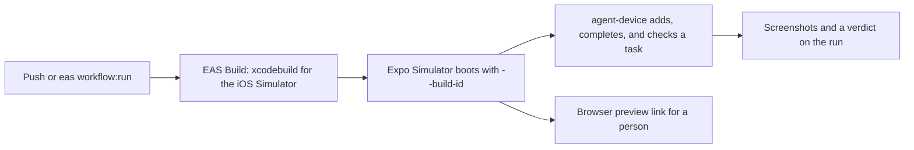

# Simple Todo, native edition: EAS + Expo Simulators for a Swift app

The same three-screen todo app as [jacobhammerle/todo-app](https://github.com/jacobhammerle/todo-app), rewritten in SwiftUI. There is no Expo SDK, no React Native, and no JavaScript in the app. The point of the repo is the delivery: [EAS Build](https://docs.expo.dev/build/introduction/) compiles the Xcode project, [Expo Simulators](https://docs.expo.dev/eas/simulators/) runs it in the cloud, [agent-device](https://docs.expo.dev/agents/agent-device/) drives it, and [EAS Workflows](https://docs.expo.dev/eas/workflows/get-started/) tie the three together. EAS is not only for React Native apps.

| | Expo version | This repo |
| --- | --- | --- |
| App | Expo Router + `@expo/ui` | SwiftUI (`ios/SimpleTodo/`) |
| Build | EAS Build | EAS Build, `simulator` profile in [eas.json](eas.json) |
| Run in the cloud | Expo Simulators | Expo Simulators, stock iOS Simulator |
| Drive | argent / agent-device | agent-device, through the accessibility tree |
| Ship JS changes | EAS Update | Not applicable: every change is a build |

## Three ways to put a native app on an Expo Simulator

Expo Simulators starts a stock iOS Simulator and installs whatever you give it. The app has to be a simulator build: a `.tar.gz` of the `.app` built against the `iphonesimulator` SDK. All three paths below are in [scripts/expo-simulator/smoke-test.sh](scripts/expo-simulator/smoke-test.sh) as `--build-id`, `--archive-url`, and `--app`.

1. **An EAS Build.** `eas build --platform ios --profile simulator` compiles the Xcode project on an EAS macOS worker. Then `eas simulator:start --build-id <id>` installs and launches it before the session is ready.
2. **Any archive URL.** Build anywhere, publish the `.tar.gz` to a URL, and pass `eas simulator:start --application-archive-url <url>`. The EAS Build artifact URL (`eas build:view <id> --json` → `artifacts.applicationArchiveUrl`) works, and so does your own storage. This is the path from the [native app guide](https://docs.expo.dev/preview/simulators/works-with/native-ios-and-android/).
3. **A local build.** `npm run build:simulator` runs `xcodebuild` on your Mac. A blank session is started and `agent-device install` uploads the bundle.

In every case the session is driven the same way, through `eas simulator:exec`:

```bash
eas simulator:exec npx agent-device@latest open com.sunrisesolutions.simpletodo.native --platform ios
eas simulator:exec npx agent-device@latest fill 'id="task-title-input"' "Verified on an Expo Simulator"
eas simulator:exec npx agent-device@latest press 'id="add-task"'
eas simulator:exec npx agent-device@latest screenshot ./artifacts/tasks.png
```

The SwiftUI views carry accessibility identifiers (`task-title-input`, `add-task`, `clear-history`, `preset-fresh`, …) so a script or an agent can target controls without coordinates.

## Workflows

Three [EAS Workflows](.eas/workflows/) run on EAS. They work from the CLI (`eas workflow:run <file>`) and on push or pull request once the GitHub repository is connected on expo.dev.



1. **[build-simulator.yml](.eas/workflows/build-simulator.yml)** builds the iOS Simulator app on every push to `main` that touches `ios/`. The run ends with the commands that use the build.
2. **[simulator-smoke.yml](.eas/workflows/simulator-smoke.yml)** builds (or takes a build id), boots an Expo Simulator with the build, and runs [smoke-test.sh](scripts/expo-simulator/smoke-test.sh): wait for the Tasks screen, add a task, complete it, open Done, open Admin. Each step is screenshotted and the script's exit code is the job's verdict. The screenshots and `report.md` are uploaded as the run's `smoke-test-screenshots` artifact.
3. **[pr-live-preview.yml](.eas/workflows/pr-live-preview.yml)** builds (or takes a build id) and boots a session that stays up for 30 minutes. The run's last job shows the browser link, so anyone with project access can tap through the native app from a browser tab. With `-F pr_number=<n>` and a `GITHUB_TOKEN`, the link is also posted on the PR.

```bash
eas workflow:run simulator-smoke.yml
eas workflow:run simulator-smoke.yml -F build_id=<id> -F device="iPhone 17 Pro"
eas workflow:run pr-live-preview.yml -F build_id=<id> -F duration_minutes=45
```

## What the Admin tab shows

A screenshot from a cloud simulator should say which build it shows. [scripts/write-build-info.sh](scripts/write-build-info.sh) is an Xcode run-script phase that stamps `BuildSource` (`eas` or `local`), `EASBuildID`, `EASBuildProfile`, and `GitCommit` into the Info.plist of the built bundle. On EAS Build the values come from the built-in `EAS_BUILD_ID`, `EAS_BUILD_PROFILE`, and `EAS_BUILD_GIT_COMMIT_HASH` variables. The Tasks screen footer shows one line of it (`eas simulator · 1.0.0 (1) · ab12cd3`) and the Admin tab shows all of it, next to the demo-data presets that reset the list mid-demo.

## Run it yourself

```bash
npm run build:simulator                                   # xcodebuild → build/SimpleTodo.app(.tar.gz)
npm run smoke -- --app build/SimpleTodo.app               # upload it to an Expo Simulator and test it
npm run smoke -- --build-id <eas-build-id>                # or test an EAS Build
npm run preview -- --build-id <eas-build-id> --minutes 30 # or get a browser link
```

Open [ios/SimpleTodo.xcodeproj](ios/SimpleTodo.xcodeproj) in Xcode to work on the app. The project is generated from [ios/project.yml](ios/project.yml) with [XcodeGen](https://github.com/yonaskolb/XcodeGen); run `npm run xcodegen` after editing the spec and commit both. Setting the repo up on your own EAS project is in [SETUP.md](SETUP.md).

## How this differs from the Expo version

- **No over-the-air updates.** There is no JavaScript bundle, so every change ships as a new build. The Expo repo's fingerprint, repack, and channel-surfing steps have no native equivalent, and the Admin tab shows build provenance instead of update channels.
- **A `Podfile` with no pods.** The default EAS iOS pipeline runs `pod install` before it builds; [ios/Podfile](ios/Podfile) lets that step succeed. Local builds use the `.xcodeproj` directly.
- **`package.json` and `app.json` are tooling metadata.** EAS CLI reads the project id and the bundle identifier from them. Neither adds a JavaScript runtime.
- **The EAS build image is pinned** to `macos-tahoe-26.5-xcode-26.6`, the same Xcode the Expo Simulators iOS image runs, in [eas.json](eas.json).
- **The simulator jobs run on `image: latest`.** The default Linux worker image has Node 18; agent-device needs Node 22, so the custom jobs in the workflows pin the newer image.
